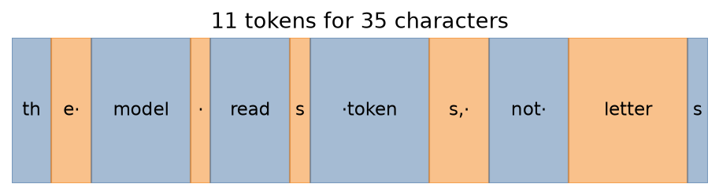
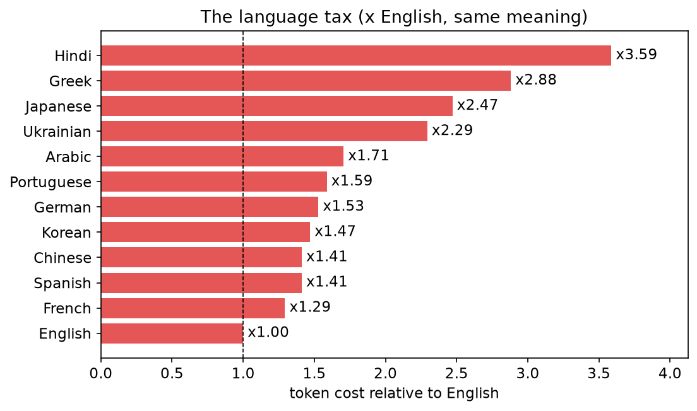

# tokenization_101

> **Your model cannot spell because it never sees letters.**
> A hands-on introduction to tokenization — the invisible first step every
> language model depends on and almost nobody understands — built from scratch
> on CPU, with no GPU and no API keys.

Ask a capable model how many times the letter **r** appears in *strawberry* and
it may well say two. That is not a reasoning failure, it is a **tokenization**
failure — and you can see exactly why by building the tokenizer yourself. This
repo trains the byte-pair-encoding (BPE) algorithm behind GPT in about fifty
lines, then uses it to explain why models can't spell, why their arithmetic
wobbles, and why the same sentence costs 2–3× more in some languages than others.

Everything runs inside a **2-CPU / 8 GB GitHub Codespace** in seconds.

---

## The one idea

A model does not read your letters or your words. It reads **tokens**: sub-word
chunks that a compression algorithm learned from a training corpus. **Whatever
the tokenizer hides, the model cannot see.** That single preprocessing choice
explains a startling list of behaviors:

| Behavior that looks like stupidity | The real, mechanical cause |
|---|---|
| Can't count the r's in *strawberry* | The word is **1–2 tokens** (in a production tokenizer), not 10 letters — the r's were never in the input |
| Spelling / reversing a word fails | Characters live *inside* an opaque token |
| Multi-digit arithmetic is unreliable | Digits split into tokens that **cut across place value** |
| The same prompt costs more in other languages | English-trained tokenizers **fragment** other scripts into 2–3× more tokens |

The from-scratch build plus three probes turn each of these from an anecdote
into a **measured** claim.

<p align="center">
  <br>
  
</p>

---

## Quickstart

```bash
make setup      # install uv, sync deps, register the Jupyter kernel
make data       # cache the training corpus + parallel multilingual sentences
make test       # run the 25 tests (round-trip, vs-reference, numbers, language tax)
make notebooks  # execute all six notebooks in place (< 3 min each)
make run        # launch the Streamlit playground
```

Run `make help` for the full target list. Python is pinned to **3.12** via
`.python-version`; the package manager is **[uv](https://docs.astral.sh/uv/)**
(no pip, no GPU).

---

## What's inside

### The from-scratch tokenizer (`src/bpe/`)

```python
from src.bpe import BPETokenizer
from src.datasets.corpora import training_corpus

tok = BPETokenizer().train(training_corpus(60_000), vocab_size=512)
tok.pieces("learning")            # -> ['learn', 'ing']   ('ing' crystallized into one learned token)
tok.decode(tok.encode("café"))    # -> 'café'             (exact byte-level round-trip, any Unicode)
```

The *strawberry* headline is clearest on a **production** tokenizer, where the
word (and the r's inside it) is just one or two opaque tokens:

```text
'strawberry'  -> ['st', 'raw', 'berry']   # gpt2: 3 tokens; the r's hide inside 'raw' / 'berry'
' strawberry' -> [' strawberry']          # gpt2: 1 token — count its r's and you're guessing
```

A small from-scratch tokenizer fragments more (`strawberry` → 8 pieces here),
which is itself the lesson: how a word tokenizes depends entirely on the vocab
the algorithm learned. Notebook 02 validates the from-scratch version against
`tiktoken` so the comparison is honest.

The algorithm in full: represent the corpus as **bytes**, count every adjacent
pair, **merge the most frequent pair** into a new symbol, record the rule, and
repeat until the vocabulary reaches the target size — see
[`src/bpe/train.py`](src/bpe/train.py). `tiktoken` and HF `tokenizers` are used
**only to validate** the from-scratch version, never as the implementation.

### The three probes (`src/probes/`)

- **spelling** — how a word tokenizes and whether its characters are individually visible.
- **numbers** — how digit strings split, and whether the split respects place value.
- **multilingual** — token counts for the same meaning across 12 languages (the *language tax*).

### The notebooks (`notebooks/`) — the argument, in order

| # | Notebook | What it shows |
|---|---|---|
| 01 | `text_is_not_characters` | One string as chars / bytes / tokens; the model receives the token row. Introduces tokens-per-character. |
| 02 | `bpe_from_scratch` *(showpiece)* | Build BPE end to end; watch chunks crystallize; tested round-trip; validate vs tiktoken. |
| 03 | `why_models_cant_spell` *(core)* | Tokenize *strawberry* & friends; characters aren't present; space/capitalization brittleness. |
| 04 | `numbers_and_arithmetic` | Digits split across place values; why tool use fixes arithmetic. |
| 05 | `the_language_tax` | The same sentence across 12 languages → money, context, and quality costs, as a ratio. |
| 06 | `decision_framework` | The vocab-size trade-off, a decision checklist, and the shipped library end to end. |

### Reproducible outputs (`outputs/`)

Every notebook writes: each figure as a PNG in
[`outputs/figures/`](outputs/figures/) and each textual/numerical input and
result as JSON in [`outputs/data/`](outputs/data/). The whole project reproduces
to a folder of 9 figures and 11 data files with one `make notebooks`.

### The Streamlit app (`app/streamlit_app.py`)

Four interactive tools — a live tokenizer, the spelling probe, the number probe,
and a language-tax meter. Launch with `make run`.

---

## Repository layout

```
config/settings.yaml   # vocab sizes, corpora, languages, seeds (pydantic-settings)
src/
  bpe/                 # train, encode, decode, vocab inspection + BPETokenizer
  reference/           # validate against tiktoken / HF tokenizers (offline-safe)
  probes/              # spelling, numbers, multilingual
  datasets/            # the English corpus + parallel multilingual sentences
  evaluation/          # compression, vocab coverage, per-language cost
  visualisation.py     # shared matplotlib helpers
  artifacts.py         # save_figure() / save_json() → outputs/
app/                   # the Streamlit playground
notebooks/             # 01–06, the narrative
tests/                 # 25 tests, all CPU, all offline
outputs/{figures,data} # generated PNGs and JSON
```

---

## Tested claims

The project's claims are asserted, not decorative (`make test`):

- **Round-trip:** `decode(encode(x)) == x` for arbitrary input, including CJK, Arabic, and emoji.
- **Vs reference:** the from-scratch merges reproduce a hand-traced, known-answer sequence on a fixed corpus (and agree with tiktoken when online).
- **Numbers:** digit tokenization splits across place values.
- **Language tax:** non-English costs materially more tokens for matched content, as a ratio.

`make ci` (sync → lint → test) is the full gate: `ruff` + `ty` clean, 25 tests passing.

---

## Related projects

Part of the **`_101` series** by [Dima806](https://github.com/Dima806).
Tokenization is the step *before* both the transformer and the embedding:

- **[transformers_101](https://github.com/Dima806/transformers_101)** — the architecture behind every large language model and most of modern AI, built from scratch in numpy on CPU at toy scale. *(Tokens are the input the transformer consumes; attention comes after.)*
- **[embeddings_101](https://github.com/Dima806/embeddings_101)** — the representation underneath every modern language, search, and recommendation system, from word co-occurrences up to a trained-from-scratch word2vec and a modern sentence encoder, all on CPU. *(Each token becomes a vector; tokenization decides what gets one.)*
- **[information_theory_101](https://github.com/Dima806/information_theory_101)** — entropy, cross-entropy, and mutual information, the three ideas that quietly power almost everything a data scientist touches. *(BPE is compression; tokens-per-character is an information-theory measure.)*
- **[hashing_101](https://github.com/Dima806/hashing_101)** — the one trick that quietly powers deduplication, feature engineering, database joins, near-duplicate detection, and streaming analytics, built entirely from scratch on CPU. *(The vocabulary as a learned dictionary over byte sequences.)*

---

## References

- Sennrich, Haddow & Birch (2016), *Neural Machine Translation of Rare Words with Subword Units* (BPE for NLP).
- Gage (1994), *A New Algorithm for Data Compression* (the original BPE).
- Kudo (2018), *Subword Regularization* (Unigram); Kudo & Richardson (2018), *SentencePiece*.
- Petrov et al. (2023), *Language Model Tokenizers Introduce Unfairness Between Languages* (the language tax).
- Radford et al. (2019), *Language Models are Unsupervised Multitask Learners* (GPT-2 byte-level BPE).

## License

[Apache-2.0](LICENSE).
